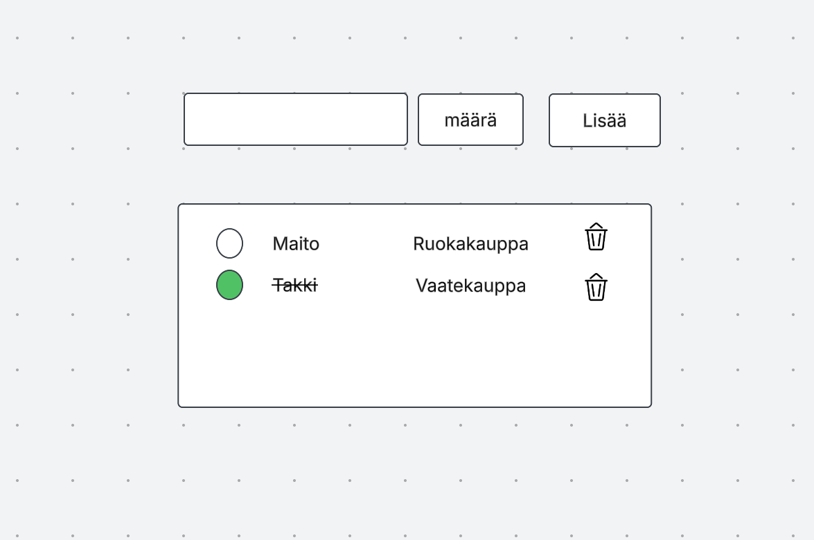

# Projektin nimi

**Tekijä(t):** Kasperi Helin

## Projektisuunnitelma

### Projektin idea

Tarkoitettu kaikille ketkä käy kaupassa tämä helpottaa sitä

### Suunnitellut toiminnot

Listaa vähintään kolme sovellukseesi suunniteltua toimintoa:

- Toiminto 1
Pystyy lisäämään tuotteita ja määrää
- Toiminto 2
Poistamaan
- Toiminto 3
Pystyy merkitsemään mitä kerännyt

### Rautalankamalli / luonnos

Lisää tähän kuva käsin piirtämästäsi tai digitaalisesti tehdystä sovelluksen luonnoksesta. Luonnoksessa tulee näkyä sovelluksen pääasiallinen näkymä ja tärkeimmät elementit.

Esimerkki kuvan lisäämisestä:

## Verkkolinkit

- **Julkaistu sovellus:** [Lisää tähän GitHub Pages -osoite](https://kasperihelin1.github.io/Laurea-web-Kehitys-1-HTML-CSS/Projekti01_DOM/)
- **GitHub-repositorio:** [Lisää tähän repositorion osoite](https://github.com/KasperiHelin1/Laurea-web-Kehitys-1-HTML-CSS/tree/main/Projekti01_DOM)
- **Projektin videoesittely:** [Lisää tähän videon osoite](https://youtu.be/lO2Lom9XlIM)

## Tietoja sovelluksesta

**[Easyshop]** on verkkosovellus, jossa heitätään kaupassa käynnin vanhanaikaisuus ulos ikkunasta.
Pystyt yhdellä napin painalluksella yliviivaamaan tuotteen, jonka olet ottanut ja poistamaan tarvittaessa tuotteita.
Huom. säästät myös paperia

Kuvaile lyhyesti sovelluksen tarkoitus ja tärkeimmät toiminnot.

## Teknologiat

- HTML – sivun rakenne
- CSS – ulkoasu ja asettelu
- JavaScript – toiminnallisuus, DOM-skriptaus ja lomakkeiden validointi
- localStorage – tietojen tallentaminen selaimeen, jos käytit sitä

## Sovelluksen käyttö

1. Avaa julkaistu sovellus yllä olevasta linkistä.
2. Täytä lomakkeen kentät.
3. Lisää, muokkaa, poista tai merkitse kohteita tehdyiksi.
4. Voit sammuttaa selaimen ja lista pysyy

## Kuvakaappaukset

Lisää tähän vähintään yksi kuvakaappaus toimivasta sovelluksestasi.

Esimerkki kuvan lisäämisestä:

## Tunnetut virheet / puutteet

Suodattaminen, kaiken poistaminen yhdellä painamisella

## Oma arvio ja oppimisen reflektointi

Pohdi työtäsi ja oppimisprosessiasi.

- Missä onnistuin?
Onnistuin ideoinnissa, Html ja css

- Mikä oli haastavaa?
JavaScript. Ei ole ollut paljoa aikaa opetella enempää sitä, mutta pikkuhiljaa.

- Mitä parantaisin, jos aikaa olisi enemmän?
Parantaisin javascripti taitojani opin paljon projektin aikana

- Mitä opin HTML:stä, CSS:stä, JavaScriptistä ja DOM-skriptauksesta?
Opin paljon javascriptistä ja dom skriptauksesta, en edes ala luettelemaan niitä tähän. Html:stä ja CSS:ssän käyttö oli mukavaa sillä siitä on enemmän kokemusta.
Kuitenkin opin paljon uusia kikkoja, kun näin inspiraatiota esimerkiksi taustan muuttamisesta

- Mikä jäi epäselväksi tai mistä haluaisin oppia lisää?
Epäselvää oli javascript jouduin käyttämään yllättävän paljon tekoälyä apua projektissa.

- Oma arvio projektista: **7/10 pistettä**

## Lähteet ja kiitokset

Listaa kaikki projektissa käyttämäsi lähteet, tutoriaalit, kuvat ja koodiesimerkit.

Jos käytit ChatGPT:tä, GitHub Copilotia tai muuta tekoälytyökalua, mainitse se tässä ja kerro lyhyesti, miten se tuki työskentelyäsi.

- Tekoälyä, jota käytin oli chatgpt
  - Käytin tekoälyä aluksi ideaan, joka minulla oli alunperin sellainen koiran ulkoilutus laskuri kumpi ihminen vie enemmän viikossa.
  Siinä oli sellainen pylväs diagrammi johon käytin apuna tekoälyä, mutta jossain vaiheessa huomasin että täähän on melkein kokonaan tehty tekoälyllä kun en osannut itse tehdä niitä. Aina kuitenkin luin miten se tehtiin, joka auttoi minua tässä kauppalista tehtävässä. Tausta kuva tehtävään on tehty tekoälyllä. Aina kun kysyn tekoälyltä apua en kopioi suoraan vastausta häneltä vaan kirjoitan itse sen siitä, jotta jotenkin oppimiskokemus olisi järkevä ja lopulta varmasti lihasmuistissa kaikki.

  ## Lisenssi

Tämä projekti on lisensoitu MIT-lisenssillä.

Lisätietoa lisenssin lisäämisestä GitHub-projektiin:
https://docs.github.com/en/communities/setting-up-your-project-for-healthy-contributions/adding-a-license-to-a-repository